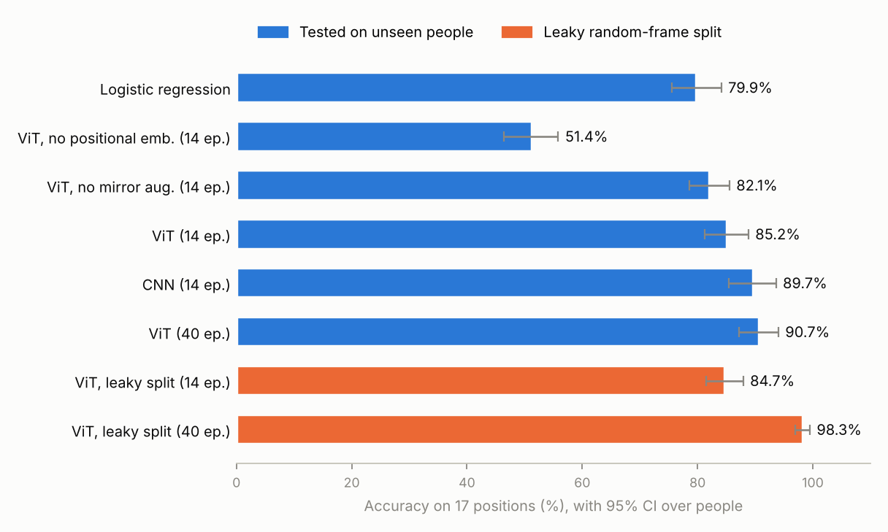
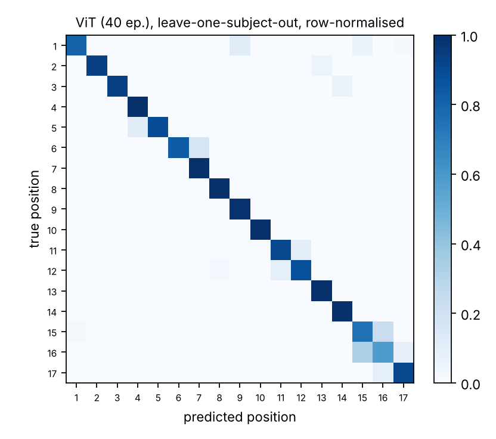
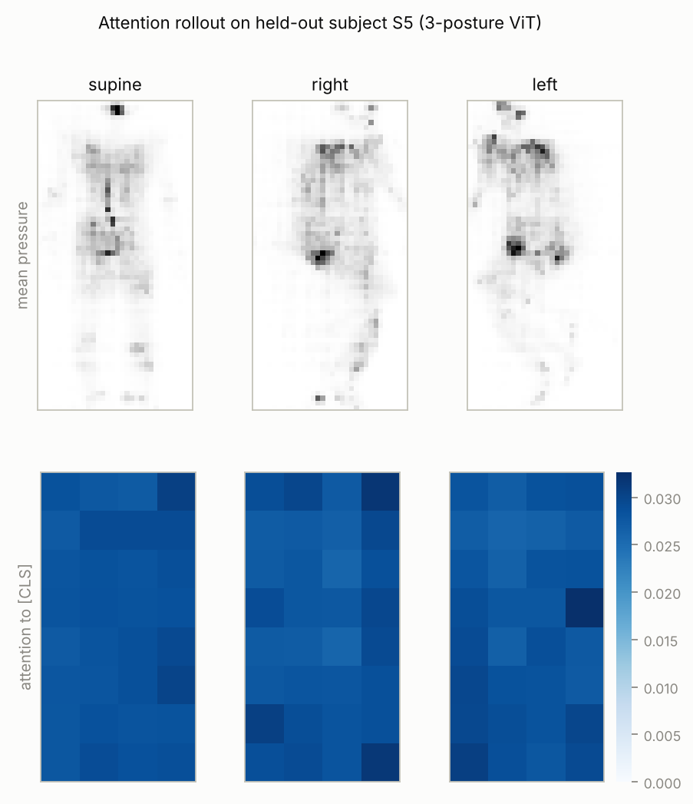

# pressure-vit

A vision transformer written from scratch in PyTorch that reads a bed's pressure map and tells how a person is lying.
It is tested only on people it has never seen.

One frame is a 64 x 32 grid of pressure sensors (2,048 readings, sampled once a second).
The model predicts either **3 postures** (supine, right side, left side) or **all 17 recorded positions**.

## Results

Every row is tested on people the model never saw (leave one subject out), except the two leaky-split rows.
Brackets are 95% intervals from bootstrapping people.

| Model, 17 positions | Epochs | Accuracy | Macro-F1 | Worst person | ECE |
|---|---|---|---|---|---|
| **ViT** | 40 | **90.7%** (87.2–94.0) | 0.906 | 78.5% | 0.069 |
| CNN, similar size | 14 | 89.7% (85.5–93.6) | 0.897 | 76.4% | 0.142 |
| ViT | 14 | 85.2% (81.2–88.8) | 0.846 | 69.6% | 0.243 |
| ViT, no mirror augmentation | 14 | 82.1% (78.6–85.5) | 0.818 | 69.7% | 0.167 |
| Logistic regression | – | 79.9% (75.5–84.1) | 0.803 | 71.0% | 0.090 |
| ViT, no positional embedding | 14 | 51.4% (46.4–55.8) | 0.492 | 37.2% | 0.125 |
| *ViT, leaky random-frame split* | 40 | *98.3% (96.9–99.5)* | 0.983 | 93.4% | 0.092 |
| *ViT, leaky random-frame split* | 14 | *84.7% (81.5–87.9)* | 0.834 | 70.7% | 0.333 |

On **3 postures** the ViT (8 epochs) reaches **95.6%** (93.1–98.2) on unseen people, with 89.2% for the hardest person.



What the numbers say:

- **A leaky split inflates accuracy by 7.6 points.** Once the model is trained to fit (40 epochs), a random frame split scores 98.3% while unseen people score 90.7%.
  The leaky split even trained on fewer frames (3,926 against about 4,540 per fold), so the gain comes from having seen the test person, not from more data.
  At 14 epochs the model was still underfitting and the gap did not appear (84.7% against 85.2%): leakage only inflates a model that can memorise.
- **Where pressure sits on the mat matters most.** Removing the positional embedding drops accuracy from 85.2% to 51.4% at the same budget.
- **Mirroring with a label swap adds 3.1 points** (82.1% to 85.2%).
- **The CNN learns faster.** At 14 epochs it beats the ViT by 4.5 points, as expected from its built-in locality.
  At 40 epochs the ViT reaches 90.7%, but the intervals overlap and the CNN was not retrained for 40 epochs, so this does not show the ViT is better.
- **Errors fall between neighbouring angles.** The weakest classes are the bed inclines (positions 15–17: 30°, 45° and 60°), where position 16 is recalled 58% of the time and mostly mistaken for 15,
  and the left-side wedges 6 and 7 (30° against 60°). These look alike on a pressure mat.
- **Calibration improves with training.** At 14 epochs the ViT was underconfident (61% mean confidence at 85% accuracy, ECE 0.24). At 40 epochs ECE is 0.069.
- **Attention rollout is close to uniform** (largest patch share 3.3% against 2.8% if spread evenly), so for this small model it does not single out body regions.

The ViT was first run for 14 epochs. It reached only 87% accuracy on its own training frames, so it was also run for 40.
That decision used training accuracy, not held-out accuracy, and both runs are reported.

<p>
  
  
</p>

## What is written by hand

- **Multi-head self-attention** (`pvit/attention.py`): queries, keys and values, scaling by 1/sqrt(d_k), masking, softmax and merging heads.
  Tests check it against PyTorch's `scaled_dot_product_attention` and `nn.MultiheadAttention` to 1e-6.
- **Patch embedding**: the frame is cut into 8 x 8 tiles (32 patches) with reshape and permute, then projected to 64-d tokens.
- **ViT**: a [CLS] token, learned positional embedding and 4 pre-LayerNorm blocks. About 0.14M parameters.
- **Attention rollout** (Abnar & Zuidema, 2020), to see which body regions the model uses.

PyTorch supplies only basic layers (`Linear`, `LayerNorm`, `GELU`, `Dropout`), softmax and the optimiser.
No `nn.MultiheadAttention`, `nn.TransformerEncoder` or pretrained weights are used.

## How it is evaluated

- **Leave one subject out.** For each of the 13 people, train on the other 12 and test on that person. Every headline number comes from unseen people.
- **95% intervals by bootstrapping people, not frames**, because frames from one person are not independent.
- Also reported: macro-F1, worst-person accuracy and expected calibration error (ECE).
- **Leakage check.** The same model is also trained on a random frame-level split.
  Near-identical frames from one recording then fall on both sides of the split, and the gap from the subject-level number shows how much a leaky split inflates results.
- **Baselines and ablations**: logistic regression on pooled pixels, a CNN with a similar parameter budget, a ViT without positional embedding, and a ViT without mirror augmentation.

Hyperparameters are fixed in advance and never tuned on a held-out person. The one change, raising the ViT from 14 to 40 epochs, is explained under Results.

## Data handling

- Readings above the sensor's 1,000 limit (0.56% of all readings) are clipped as hot pixels.
- Each frame is divided by its total load, so the model learns body shape rather than body weight.
- The first 3 frames of each recording are dropped while the person settles.
- Training uses every 4th frame, since neighbouring 1 Hz frames are nearly identical. Testing uses every frame.
- Augmentation: shifts of up to 2 sensors, +/-15% gain jitter, and a left-right mirror that **swaps the label** too (a right-side frame mirrored becomes a left-side frame).

The reasoning behind each choice is in [`docs/DESIGN_NOTES.md`](docs/DESIGN_NOTES.md).

## Run it

```bash
pip install -r requirements.txt
pytest -q                                   # attention parity, masking, patchify, shapes

# Download Experiment I from PhysioNet (link below), then:
python scripts/run_experiments.py --data <path>/experiment-i --ablations
python scripts/run_experiments.py --data <path>/experiment-i --only vit_position_loso_40ep vit_position_random_frames_40ep
python scripts/make_figures.py <path>/experiment-i
```

Everything runs on a CPU: about 2.5 hours on 2 cores for the full set. `--quick` runs a 2-person, 2-epoch smoke test.

## Layout

```
pvit/attention.py    multi-head self-attention
pvit/model.py        patch embedding, ViT, attention rollout
pvit/data.py         loading, preprocessing, position-to-posture and mirror maps
pvit/train.py        augmentation, training loop, leave-one-subject-out
pvit/metrics.py      subject bootstrap CIs, macro-F1, ECE
pvit/baselines.py    CNN and logistic regression
scripts/             experiments and figures
tests/               unit tests
```

## Data and licence

The data is **not** included in this repository. It is "A Pressure Map Dataset for In-bed Posture Classification" (v1.0.0) on PhysioNet,
released under the [Open Data Commons Attribution License v1.0](https://physionet.org/content/pmd/view-license/1.0.0/).
This project uses Experiment I: 13 people, 17 positions, recorded on a Vista Medical FSA SoftFlex 2048 mat.

- Dataset: https://physionet.org/content/pmd/1.0.0/ (DOI [10.13026/C2W09K](https://doi.org/10.13026/C2W09K))
- M. B. Pouyan, J. Birjandtalab, M. Heydarzadeh, M. Nourani and S. Ostadabbas, "A pressure map dataset for posture and subject analytics,"
  *2017 IEEE EMBS International Conference on Biomedical & Health Informatics (BHI)*, 2017. DOI [10.1109/BHI.2017.7897206](https://doi.org/10.1109/BHI.2017.7897206)
- PhysioNet: T. Pollard et al., "PhysioNet as a global platform for biomedical research," *Nature Health*, 1(8), 792–795, 2026.
  DOI [10.1038/s44360-026-00096-z](https://doi.org/10.1038/s44360-026-00096-z)
